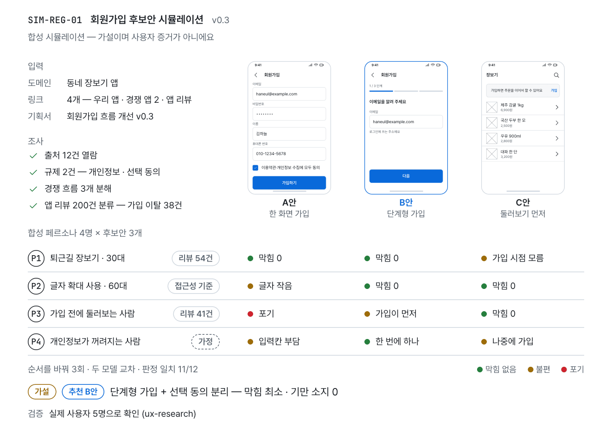
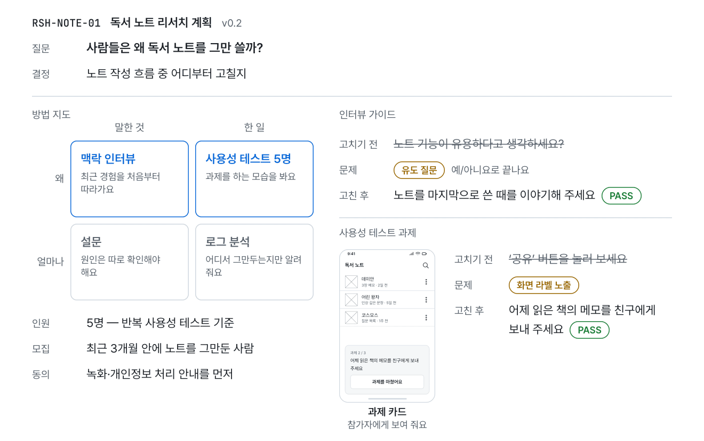
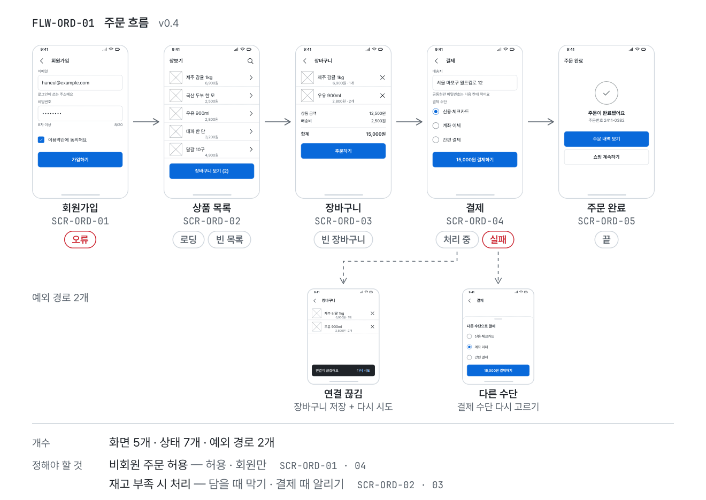
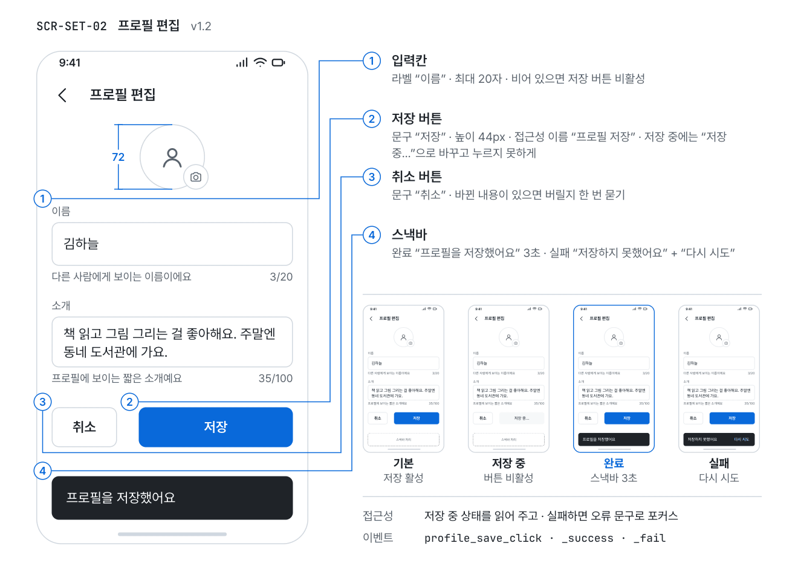
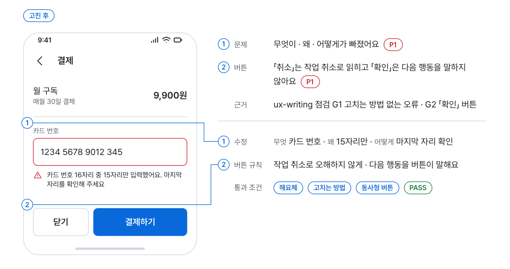
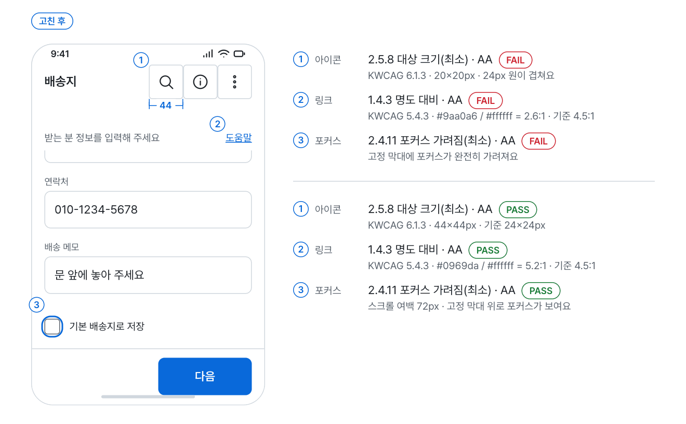
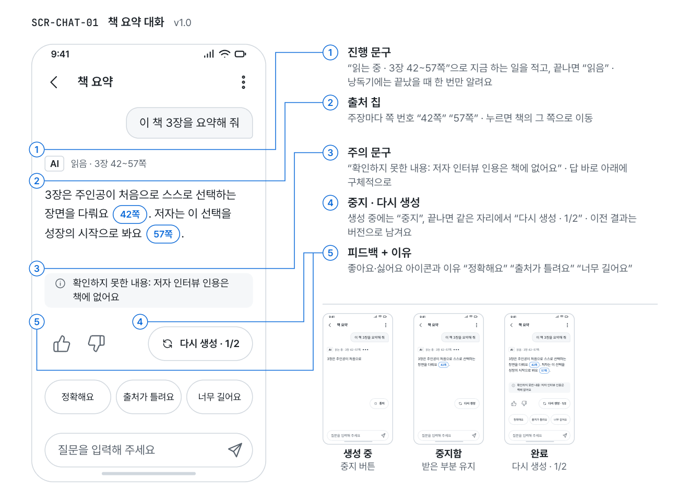

<div align="center">

<picture>
  <source media="(prefers-color-scheme: dark)" srcset="https://raw.githubusercontent.com/Power-xc/power-ux-harness/main/assets/demos/hero-dark.gif">
  
</picture>

# power-ux-harness

**Ten skills that make an AI coding agent design and review UX the way a senior product designer works.**

Hand it a planning doc and a few links: it opens every source, then lets cited synthetic personas try your candidate designs first.<br>
Flows, screen specs, UX copy, reviews, accessibility, deceptive-pattern checks and metrics follow with the same vocabulary and the same verdicts.

[](https://github.com/Power-xc/power-ux-harness/actions/workflows/ci.yml)


[](LICENSE)

**[Install](#install)** · [The ten skills](#the-ten-skills) · [Example requests](#example-requests) · [Shared vocabulary](#shared-vocabulary) · [Skill guide (KO)](https://power-ux-harness-guide.vercel.app) · [한국어](README.md)

</div>

## At a glance

- **Start from a planning doc** — give it a domain, links and a doc; it opens every source into a citation table, and personas with cited attributes walk through the candidate designs.
- **Hypotheses stay hypotheses** — synthetic results are labeled as such on the first line, reported as rankings and stability instead of percentages, and always end in a real-user validation plan.
- **Fixes name the pattern** — not "improve feedback" but "snackbar + Undo, 'Note deleted'": pattern, state and copy.
- **Verdicts against standards** — WCAG 2.2, KWCAG 2.2, Korea's dark-pattern guideline and e-commerce act, HEART and SUS, with item numbers behind every PASS or FAIL.
- **Skills hand off to each other** — every skill uses the same evidence labels and the same priorities (P1–P3), so one skill's output is the next skill's input.
- **Any agent** — two lines for the Claude Code plugin, one `npx` line for Codex, Cursor, Gemini CLI and Copilot.

The skill files are written in Korean. Agents read them without trouble and answer in the language you ask in, and `ux-writing` carries English UI-copy rules as well as Korean ones. The demo GIFs show Korean UI.

## Flow

Following one feature from the first question to release looks like this. You can also call any single skill on its own.

| Step             | Skill              | Produces                                                                    |
| ---------------- | ------------------ | --------------------------------------------------------------------------- |
| Explore          | `ux-simulate`      | Source table · synthetic personas · ranked candidates · real-user test plan |
| Confirm          | `ux-research`      | Research plan · interview guide · usability-test tasks · synthesis          |
| Define           | `ux-flow`          | Flow diagram · screen list · screen × state table · navigation              |
| Design           | `ux-spec`          | Screen spec with numbered regions · handoff checklist                       |
| Copy             | `ux-writing`       | Error, button, empty-state and dialog copy · glossary                       |
| Review           | `ux-review`        | Heuristic and pattern verdicts · P1–P3 findings · fixes                     |
| Accessibility    | `ux-a11y`          | WCAG 2.2 and KWCAG 2.2 audit                                                |
| Deceptive design | `ux-dark-patterns` | Verdicts on 13 types · sign-up vs. cancel path comparison                   |
| Measure          | `ux-metrics`       | HEART metrics · guardrails · experiment plan                                |
| AI screens       | `ux-ai`            | 18 human–AI interaction guidelines · AI screen patterns                     |

## The ten skills

### ux-simulate

**Desk research → synthetic personas → candidate walkthroughs → recommendation and validation plan.**

<picture>
  <source media="(prefers-color-scheme: dark)" srcset="https://raw.githubusercontent.com/Power-xc/power-ux-harness/main/assets/demos/simulate-dark.gif">
  
</picture>

Given a domain, links and a planning doc, it opens every source and tags it with an ID, then researches the rules that apply, how similar services structure the flow, and what app reviews complain about. Three to five personas built from structured attributes walk through two or three candidate designs step by step (a cognitive walkthrough), and the least obstructed candidate is recommended with its chain of evidence.

- **When** — "Here's the doc and some links, which UX fits?", "Narrow the options before we interview anyone", `@ux simulate`, `@ux discover`
- **Personas** — every attribute carries a source ID or `가정` (assumption); an accessibility or edge persona and a skeptic are mandatory. It also explains how to draw a stratified sample from a public synthetic-persona dataset aligned to Korean population statistics.
- **Trustworthy runs** — repeated runs with shuffled order and labels (three by default), an empty persona and a demographics-only baseline, a hidden decoy option with a deliberate flaw, and a log of model, prompt and date.
- **Never** — percentages like "70% of users prefer", citing a source it did not open, or a recommendation without a validation plan.

### ux-research

**Pick the method that fits the question, design interviews and usability tests, and turn findings into a decision.**

<picture>
  <source media="(prefers-color-scheme: dark)" srcset="https://raw.githubusercontent.com/Power-xc/power-ux-harness/main/assets/demos/research-dark.gif">
  
</picture>

- **When** — "Why do people drop out of onboarding?", "Tasks and a script for five participants next week", "Turn these eight interview transcripts into what we fix next"
- **What it does** — narrows the question to one decision, chooses methods by what people say vs. do and why vs. how much, asks about past behavior instead of opinions, keeps screen labels out of tasks, and recruits five per round.
- **Aliases** — `@ux research` · `@ux interview` · `@ux usability-test`

### ux-flow

**Flow diagrams with the happy, error and recovery paths, a screen list, and a screen × state table.**

<picture>
  <source media="(prefers-color-scheme: dark)" srcset="https://raw.githubusercontent.com/Power-xc/power-ux-harness/main/assets/demos/flow-dark.gif">
  
</picture>

- **When** — "Screens and edge cases from sign-up to first order", "Structure the My Page menu"
- **What it does** — draws the task flow in Mermaid, gives every screen an ID (`SCR-ORD-03`), records loading, empty, error, done and end states, and collects open policy questions separately.
- **Aliases** — `@ux flow` · `@ux ia`

### ux-spec

**A screen spec with numbered regions: component name, behavior, states, copy, data, accessibility and events for each.**

<picture>
  <source media="(prefers-color-scheme: dark)" srcset="https://raw.githubusercontent.com/Power-xc/power-ux-harness/main/assets/demos/spec-dark.gif">
  
</picture>

- **When** — "A spec developers can build from", "A screen spec an agent can implement directly"
- **What it does** — pins down names people mix up (toast vs. snackbar, dialog vs. bottom sheet) so design, engineering and agents call the same thing by the same name, and runs a handoff checklist for missing states and copy.
- **Alias** — `@ux spec`

### ux-writing

**Error messages that say what went wrong, why and how to fix it; buttons that name the result; Korean and English rules.**

<picture>
  <source media="(prefers-color-scheme: dark)" srcset="https://raw.githubusercontent.com/Power-xc/power-ux-harness/main/assets/demos/writing-dark.gif">
  
</picture>

- **When** — "Polish these error messages", "Every button says OK, what should each say?", "Review our English UI copy"
- **What it does** — writes errors, buttons, empty states, notifications, confirmation dialogs, permission requests and form labels by Korean and English rules, and builds a glossary so one thing keeps one name.
- **Aliases** — `@ux write` · `@ux copy-review`

### ux-review

**Reviews screens against heuristics and pattern fit, and writes fixes down to pattern, state and copy.**

<picture>
  <source media="(prefers-color-scheme: dark)" srcset="https://raw.githubusercontent.com/Power-xc/power-ux-harness/main/assets/demos/review-dark.gif">
  
</picture>

- **When** — "Users seem lost in onboarding", "Delete only shows a toast; Undo or a confirmation dialog?", "A switch plus a Save button, is that OK?"
- **What it does** — finds heuristic violations along the observed path, checks whether each notification fits its interruption level (0–3), converts severity to P1–P3 and picks the one to three fixes to do first.
- **Aliases** — `@ux review` · `@ux funnel`

### ux-a11y

**WCAG 2.2 AA audits, cross-checked against KWCAG 2.2 and Korea's mobile-app accessibility standard by item number.**

<picture>
  <source media="(prefers-color-scheme: dark)" srcset="https://raw.githubusercontent.com/Power-xc/power-ux-harness/main/assets/demos/a11y-dark.gif">
  
</picture>

- **When** — "Prepare for an accessibility certification", "Can a screen-reader user finish checkout?", "Are our touch targets big enough?"
- **What it does** — checks keyboard and focus, accessible names and roles, contrast, target size, time limits, forms and authentication, and labels each result as automated, manual, code-inferred or not checked.
- **Alias** — `@ux a11y`

### ux-dark-patterns

**Checks sign-up, checkout, subscription, consent and cancel flows against Korea's 13 dark-pattern types and its e-commerce act.**

<picture>
  <source media="(prefers-color-scheme: dark)" srcset="https://raw.githubusercontent.com/Power-xc/power-ux-harness/main/assets/demos/dark-patterns-dark.gif">
  
</picture>

- **When** — "Is our cancel flow legal?", "An add-on is pre-checked at checkout", "Is this pop-up too frequent?"
- **What it does** — counts the steps of the sign-up and cancel paths side by side, pairs each type with an honest alternative, adds EU DSA and US FTC checks for overseas users, and leaves the final legal call to counsel.
- **Alias** — `@ux dark`

### ux-metrics

**HEART with goals, signals and metrics, guardrails, SUS, and experiment plans with decision rules written first.**

<picture>
  <source media="(prefers-color-scheme: dark)" srcset="https://raw.githubusercontent.com/Power-xc/power-ux-harness/main/assets/demos/metrics-dark.gif">
  
</picture>

- **When** — "Define success metrics", "Will a step-by-step sign-up raise the completion rate?", "Score our SUS survey"
- **What it does** — defines metrics per user (denominator, window, unit), adds guardrails, writes the decision rule before the experiment starts, and falls back to usability testing when traffic is too small, stating the limit.
- **Aliases** — `@ux metrics` · `@ux experiment`

### ux-ai

**AI feature screens: stating limits, stopping generation, exact citations, regeneration that keeps versions, approval before actions, failure handling.**

<picture>
  <source media="(prefers-color-scheme: dark)" srcset="https://raw.githubusercontent.com/Power-xc/power-ux-harness/main/assets/demos/ai-dark.gif">
  
</picture>

- **When** — "Design our AI chat screen", "Where do citations and Regenerate go?", "What should the agent show before it sends an email for me?"
- **What it does** — checks 18 human–AI interaction guidelines across first use, during use, when wrong and over time, and names screen elements by pattern (suggested prompts, streaming + Stop, citation chips, approval before action …).
- **Alias** — `@ux ai`

## Example requests

| Ask                                                                                               | Fires              |
| ------------------------------------------------------------------------------------------------- | ------------------ |
| Use the doc and market data to run personas and tell me which of two onboarding options is better | `ux-simulate`      |
| I'm testing a new booking flow with five users next week, write the tasks and the script          | `ux-research`      |
| List the screens and edge cases from sign-up to first order                                       | `ux-flow`          |
| Spec just the payment-method screen: components, states and copy by region                        | `ux-spec`          |
| Every button says OK, decide what each screen's button should say                                 | `ux-writing`       |
| Delete only shows a toast that disappears; should we add Undo or a confirmation dialog?           | `ux-review`        |
| Can a screen-reader user get through checkout? Check contrast and focus order                     | `ux-a11y`          |
| The cancel button sits small at the bottom of My Page, is that a dark pattern?                    | `ux-dark-patterns` |
| Set metrics and guardrails to tell whether the onboarding revamp worked                           | `ux-metrics`       |
| What confirmation should an AI agent show before sending an email for me?                         | `ux-ai`            |

All 36 request–skill pairs live in [`evals/cases.json`](evals/cases.json). Requests that are easy to confuse with a neighboring skill carry `shouldNotFire`, which pins the boundary.

## Install

### Claude Code

```text
/plugin marketplace add Power-xc/power-ux-harness
/plugin install power-ux-harness@power-ux-harness
```

### Codex · Cursor · Gemini CLI · GitHub Copilot

Installs into `.agents/skills`, the project location several agents read. Requires Node.js 22 or later.

```sh
npx github:Power-xc/power-ux-harness                    # all ten into this project
npx github:Power-xc/power-ux-harness --only ux-review,ux-a11y
npx github:Power-xc/power-ux-harness --tool both        # .agents/skills and .claude/skills
npx github:Power-xc/power-ux-harness --list             # list the skills
```

Re-running skips identical files and never overwrites a file you edited unless you pass `--force`. `--dry-run` prints the plan first.

### Copy by hand

Copy `skills/<id>` into your agent's skills folder. Each folder works on its own; the body completes the procedure even without another skill's reference files.

## Shared vocabulary

Every skill uses these words in the same sense. That is how `ux-spec` turns a `ux-review` finding into a spec as is, and how `ux-research` takes a `ux-simulate` hypothesis as its test task.

| Term                        | Meaning                                                                                 |
| --------------------------- | --------------------------------------------------------------------------------------- |
| `observed`                  | Seen directly on a screen, prototype or recording                                       |
| `code-inferred`             | Confirmed from code and state branches but not rendered                                 |
| `reported`                  | Said by a participant or customer                                                       |
| `hypothesis`                | Inferred; synthetic simulation results always belong here                               |
| `PASS` · `FAIL` · `BLOCKED` | Verdicts of review skills; BLOCKED means environment or access stopped a required check |
| `N/A` · `NOT_CHECKED`       | Does not apply · applies but was not checked                                            |
| `P1` · `P2` · `P3`          | Task impossible, loss, deception / flow stops, round trips / friction                   |

## Standards

Verdicts rest on published standards; each skill's `references/` opens with its sources and their publication or effective dates.

- **Accessibility** — WCAG 2.2, KWCAG 2.2 (KS X OT0003:2022), Korea's mobile-app content accessibility standard (KS X 3253:2025)
- **Deceptive design** — the dark-pattern provisions of Korea's e-commerce consumer-protection act (in force 2025-02-14), the Korea Fair Trade Commission's guideline on online interfaces against dark patterns (2026-10-06), EU DSA Article 25, the US FTC staff report
- **Research and metrics** — heuristic evaluation and severity, cognitive walkthroughs, HEART, SUS, controlled-experiment design
- **Synthetic users** — the repeat, baseline, decoy and rank-only reporting rules come from studies of the positivity bias, reduced variance and option-order bias of synthetic responses

## Checks and contributing

```sh
npm test
```

Checks skill structure and size, required section order, hard-gate numbering, relative links, chaining targets, trigger cases, the README skill list, manifest versions, and secrets, absolute paths and tool-attribution lines, then runs the script tests. No dependencies to install. The rules for adding or changing a skill are in [CONTRIBUTING.md](CONTRIBUTING.md) (Korean).

The README GIFs are rendered from the deterministic scenes in [`demos/`](demos/); edit a scene and re-render with the same command.

## Related

- [power-persona-sim](https://github.com/Power-xc/power-persona-sim) — a survey simulator that runs questionnaires and in-depth interviews at scale with synthetic personas aligned to population statistics. Where `ux-simulate` screens one design decision, it covers market research broadly.

## License

[MIT](LICENSE)
