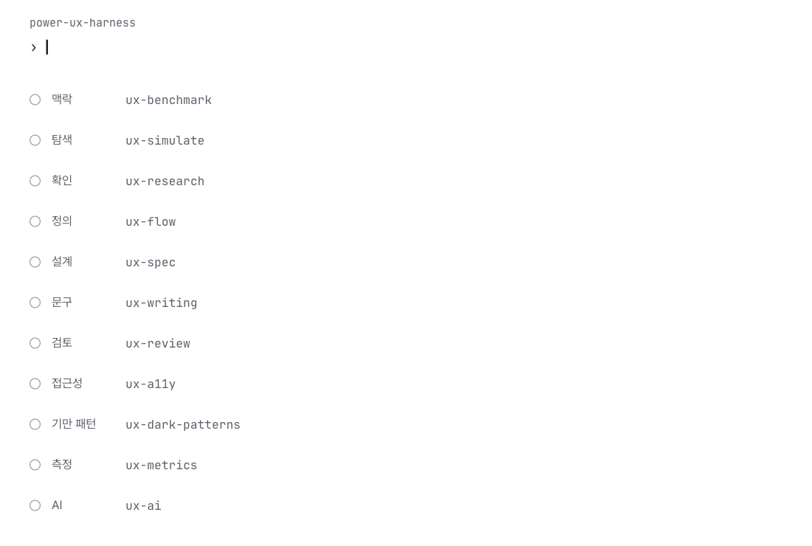
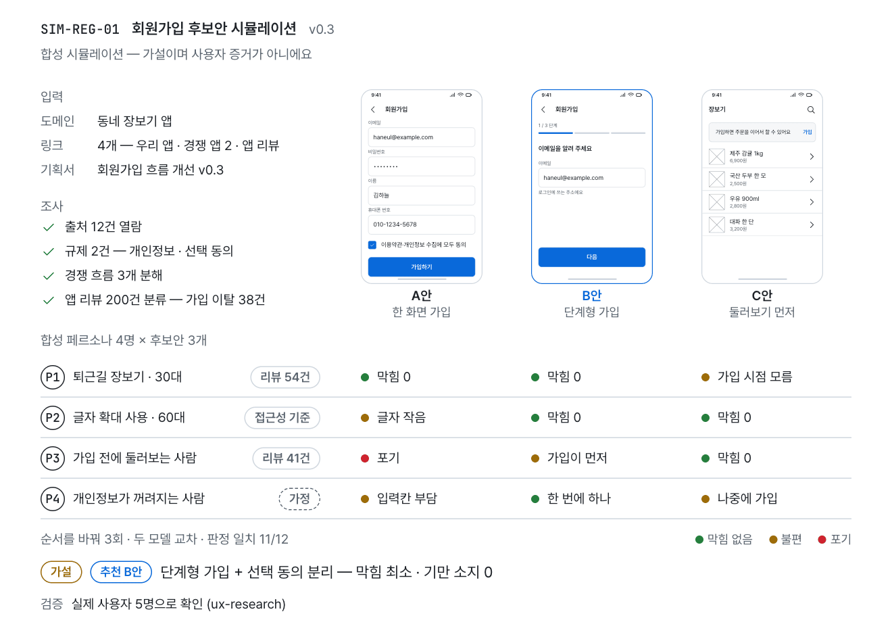
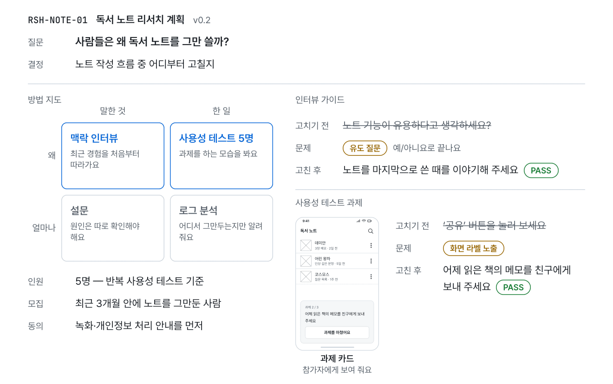
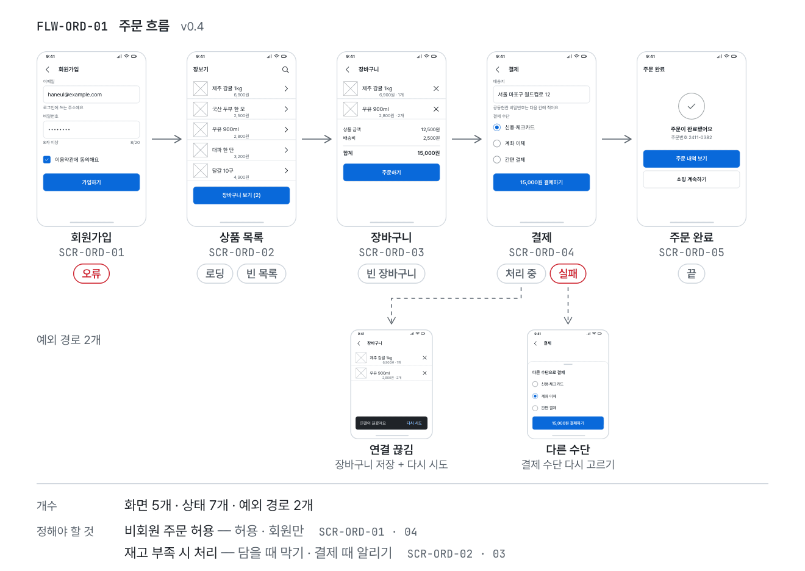
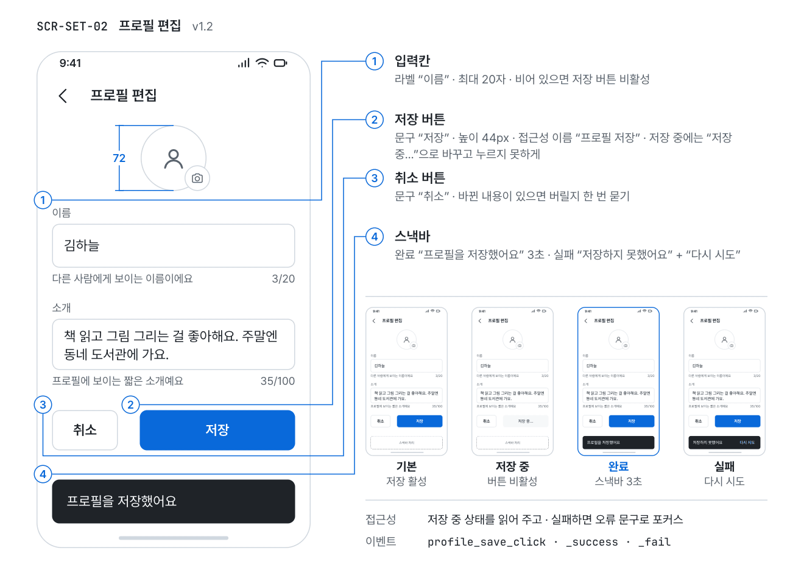
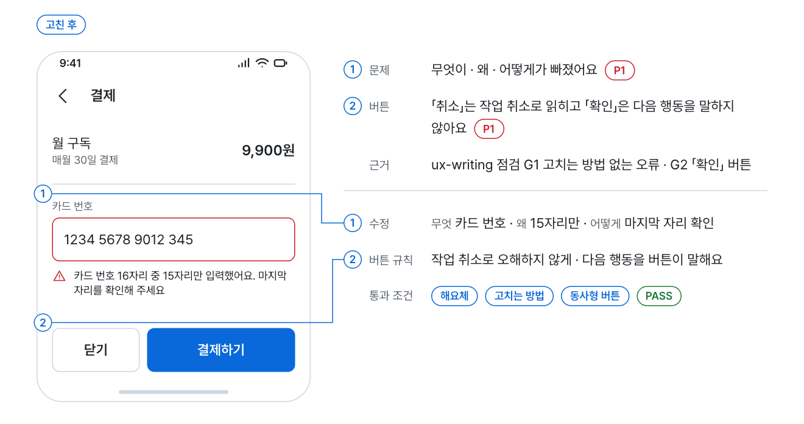
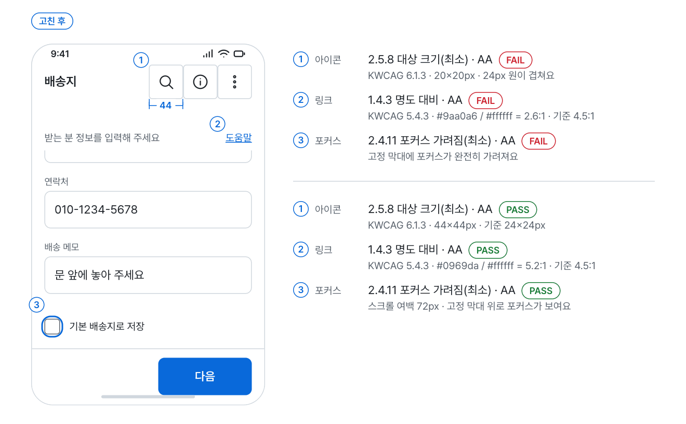
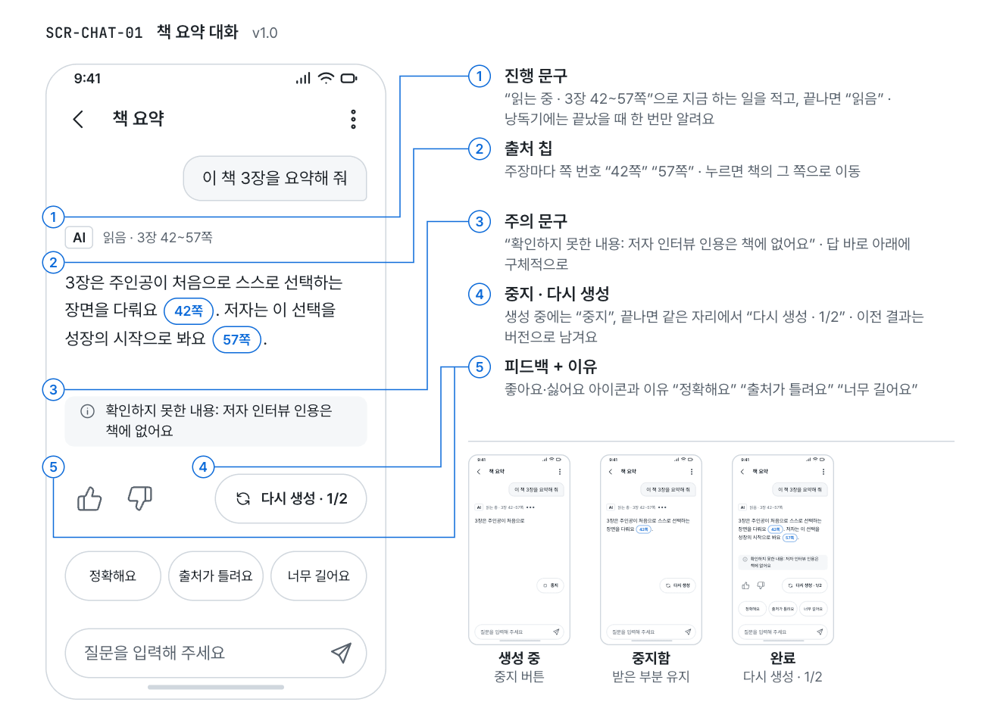

<div align="center">

<picture>
  <source media="(prefers-color-scheme: dark)" srcset="https://raw.githubusercontent.com/Power-xc/power-ux-harness/main/assets/demos/hero-dark.gif">
  
</picture>

# power-ux-harness

**AI 코딩 에이전트가 시니어 프로덕트 디자이너의 절차로 UX를 설계하고 검토하게 하는 스킬 10개.**

기획서와 링크만 넣으면 자료를 직접 열어 조사하고, 출처 붙은 합성 페르소나로 후보안을 미리 걸러 냅니다.<br>
흐름 · 화면 설계서 · 문구 · 리뷰 · 접근성 · 기만 패턴 · 지표까지, 같은 어휘와 같은 판정으로 이어집니다.

[](https://github.com/Power-xc/power-ux-harness/actions/workflows/ci.yml)


[](LICENSE)

**[설치](#설치)** · [스킬 10개](#스킬-10개) · [예시 요청](#예시-요청) · [같은 어휘](#같은-어휘) · [스킬 가이드](https://power-ux-harness-guide.vercel.app) · [English](README.en.md)

</div>

## 한눈에

- **기획서만 넣어도 시작** — 도메인 · 링크 · 기획서를 주면 받은 자료를 모두 열어 출처 표를 만들고, 출처 붙은 합성 페르소나가 후보안을 먼저 써 봅니다.
- **가설은 가설로** — 합성 결과는 첫 줄부터 가설이라고 밝히고, 비율 대신 순위와 안정성으로만 말하고, 실제 사용자 검증 계획으로 끝냅니다.
- **수정안은 패턴 이름으로** — 「피드백 강화」가 아니라 「스낵바 + 되돌리기, "노트를 삭제했어요"」처럼 패턴 · 상태 · 문구까지 적습니다.
- **기준으로 판정** — WCAG 2.2 · KWCAG 2.2, 공정위 다크패턴 가이드라인 · 전자상거래법, HEART · SUS 같은 기준과 항목 번호로 PASS · FAIL을 냅니다.
- **스킬끼리 이어짐** — 모든 스킬이 같은 증거 어휘와 같은 우선순위(P1~P3)를 써서, 한 스킬의 결과를 다음 스킬이 그대로 받습니다.
- **어느 에이전트에서나** — Claude Code는 플러그인 두 줄, Codex · Cursor · Gemini CLI · Copilot은 `npx` 한 줄로 설치합니다.

## 흐름

한 기능을 처음부터 출시 전까지 따라가면 이 순서가 됩니다. 필요한 스킬 하나만 불러도 됩니다.

| 단계      | 스킬               | 내는 것                                                       |
| --------- | ------------------ | ------------------------------------------------------------- |
| 탐색      | `ux-simulate`      | 출처 표 · 합성 페르소나 · 후보안 순위 · 실제 사용자 검증 계획 |
| 확인      | `ux-research`      | 리서치 계획 · 인터뷰 가이드 · 사용성 테스트 과제 · 결과 종합  |
| 정의      | `ux-flow`          | 흐름도 · 화면 목록 · 화면×상태 표 · 메뉴 구조                 |
| 설계      | `ux-spec`          | 영역 번호를 붙인 화면 설계서 · 핸드오프 점검                  |
| 문구      | `ux-writing`       | 오류 · 버튼 · 빈 상태 · 확인 대화상자 문구, 용어표            |
| 검토      | `ux-review`        | 휴리스틱 · 패턴 판정, P1~P3 finding, 수정안                   |
| 접근성    | `ux-a11y`          | WCAG 2.2 · KWCAG 2.2 감사표                                   |
| 기만 패턴 | `ux-dark-patterns` | 13개 유형 판정 · 가입과 해지 경로 비교                        |
| 측정      | `ux-metrics`       | HEART 지표 · 가드레일 · 실험 계획                             |
| AI 화면   | `ux-ai`            | 사람–AI 상호작용 지침 18개 점검 · AI 화면 패턴                |

## 스킬 10개

### ux-simulate

**자료 조사 → 합성 페르소나 → 후보안 시뮬레이션 → 추천과 검증 계획.**

<picture>
  <source media="(prefers-color-scheme: dark)" srcset="https://raw.githubusercontent.com/Power-xc/power-ux-harness/main/assets/demos/simulate-dark.gif">
  
</picture>

도메인 · 링크 · 기획서를 주면 받은 자료를 모두 열어 출처 ID를 붙이고, 규제 · 비슷한 서비스의 흐름 · 앱 리뷰를 조사합니다. 구조화된 속성에서 뽑은 페르소나 3\~5명이 후보안 2\~3개를 인지적 워크스루로 한 단계씩 써 보고, 가장 덜 막히는 안을 근거 사슬과 함께 추천합니다.

- **이럴 때** — 「기획서랑 링크 줄 테니 어떤 UX가 맞을지 봐 줘」, 「인터뷰 전에 안을 좁혀 줘」, `@ux simulate`, `@ux discover`
- **페르소나** — 속성마다 출처 ID나 `가정`을 달고, 접근성 · 경계 페르소나와 회의적 페르소나를 꼭 넣습니다. 국내 인구 분포에 맞춘 공개 합성 페르소나 데이터에서 층화 추출하는 방법도 담았습니다.
- **결과를 믿을 수 있게** — 후보안 순서와 이름표를 바꾼 반복 실행(기본 3회), 빈 페르소나와 인구통계만 있는 페르소나 기준선, 결함을 숨긴 미끼 안, 모델 · 프롬프트 · 날짜 기록.
- **하지 않는 것** — 「사용자의 70%가 선호」 같은 비율, 열지 않은 자료 인용, 검증 계획 없는 추천.

<details>
<summary>출력 예시 — 회원가입 흐름</summary>

```markdown
합성 시뮬레이션 — 가설이며 사용자 증거가 아니에요

결정: 회원가입 흐름을 어떤 구조로 만들까
기준(가중치, 실행 전 확정): 가입까지 막힘 없음 0.5 · 가입 전 둘러보기 0.3 · 개인정보 부담 0.2 · 기만 소지 0(필수)

| ID  | 종류          | 제목·주소                   | 연 날짜    | 쓴 곳                     |
| --- | ------------- | --------------------------- | ---------- | ------------------------- |
| S1  | 기획서        | 회원가입 흐름 개선 v0.3     | 2026-11-02 | 결정 문장                 |
| S3  | 앱 리뷰       | 최신순 200건 (2026-05~10)   | 2026-11-02 | 리뷰 분류                 |
| S4  | 규제          | 개인정보 최소 수집 · 선택 동의 조항 | 2026-11-02 | 규제 확인           |
| S5  | 비슷한 서비스 | 받은 주소                   | 2026-11-02 | NOT_CHECKED — 로그인 필요 |

리뷰 분류(S3): 가입 중 이탈 38 · 입력 항목 많음 21 · 둘러보기 불가 12

| 페르소나                    | A안 한 화면 가입   | B안 단계형 가입        | C안 둘러보기 먼저    |
| --------------------------- | ------------------ | ---------------------- | -------------------- |
| P1 퇴근길 장보기 · 30대     | 막힘 없음          | 막힘 없음              | 가입 시점 모름       |
| P2 글자 확대 · 60대         | 입력칸 글자가 작음 | 막힘 없음              | 막힘 없음            |
| P3 가입 전에 둘러보려는 사람 | 포기              | 가입이 먼저            | 막힘 없음            |
| P4 개인정보 제공이 꺼려짐   | 입력칸 부담        | 한 번에 하나만 물어 줌 | 나중에 가입          |

반복: 순서·이름표를 바꿔 3회 · 두 모델 계열 · 판정 일치 11/12
기준선: 빈 페르소나는 세 안을 구분하지 못함 → 페르소나 신호 있음
미끼 안(가입 버튼 없음): 모든 페르소나가 마지막 단계에서 실패 → 실행 유효

추천: B안 — 3회 모두 1위 (가설, 비율 아님)
근거: S3 「입력 항목 많음」 21건 → P4의 부담 → A안 입력칸 포기 → B안의 한 번에 한 가지 질문
기만 패턴 점검: 선택 동의 사전 선택 없음, 건너뛰기 버튼이 같은 크기 → 소지 없음
볼 수 없는 것: 드문 답, 감정과 신뢰, 실제 클릭 행동, 국내 사용자 대표성

검증 계획

| 가장 위험한 가설                          | 방법                           | 인원 | 뒤집을 결과                         |
| ----------------------------------------- | ------------------------------ | ---- | ----------------------------------- |
| 단계형 가입이 입력 부담을 줄인다          | 사용성 테스트 + 사후 인터뷰    | 5명  | 5명 중 2명 이상이 중간에 가입을 멈춤 |
| 글자를 키운 사용자도 가입 화면을 끝낸다   | 접근성 설정을 켠 사용성 테스트 | 3명  | 1명이라도 다음 단계 버튼을 못 찾음  |

판정: READY
```

</details>

### ux-research

**질문에 맞는 리서치 방법을 고르고, 인터뷰와 사용성 테스트를 설계하고, 결과를 결정으로 묶습니다.**

<picture>
  <source media="(prefers-color-scheme: dark)" srcset="https://raw.githubusercontent.com/Power-xc/power-ux-harness/main/assets/demos/research-dark.gif">
  
</picture>

- **이럴 때** — 「왜 온보딩 중간에 그만두는지 알고 싶어」, 「사용자 5명 불러 테스트할 과제랑 대본」, 「인터뷰 녹취 정리해서 다음에 뭘 고칠지」
- **하는 일** — 알고 싶은 것을 결정 하나로 좁히고, 말한 것과 한 일 · 왜와 얼마나로 방법을 고릅니다. 의견 대신 과거 행동을 묻고, 과제에는 화면 라벨을 쓰지 않고, 라운드당 5명으로 모집 조건을 정합니다.
- **별칭** — `@ux research` · `@ux interview` · `@ux usability-test`

### ux-flow

**정상 · 예외 · 복구 경로가 다 들어간 흐름도와 화면 목록, 화면×상태 표.**

<picture>
  <source media="(prefers-color-scheme: dark)" srcset="https://raw.githubusercontent.com/Power-xc/power-ux-harness/main/assets/demos/flow-dark.gif">
  
</picture>

- **이럴 때** — 「회원가입부터 첫 주문까지 화면 목록이랑 예외 경로」, 「마이페이지 메뉴 구조 잡아 줘」
- **하는 일** — 과제 흐름을 Mermaid로 그리고, 화면마다 ID(`SCR-ORD-03`)를 붙이고, 로딩 · 빈 · 오류 · 완료 · 끝 화면까지 상태 표로 남깁니다. 정하지 못한 정책은 「정해야 할 것」으로 따로 모읍니다.
- **별칭** — `@ux flow` · `@ux ia`

### ux-spec

**번호 붙인 영역마다 컴포넌트 이름 · 동작 · 상태 · 문구 · 데이터 · 접근성 · 이벤트를 적는 화면 설계서.**

<picture>
  <source media="(prefers-color-scheme: dark)" srcset="https://raw.githubusercontent.com/Power-xc/power-ux-harness/main/assets/demos/spec-dark.gif">
  
</picture>

- **이럴 때** — 「개발자한테 넘길 화면설계서」, 「에이전트가 바로 구현할 화면 명세」
- **하는 일** — 토스트와 스낵바, 대화상자와 바텀 시트처럼 헷갈리는 이름을 표로 고정해 디자인 · 개발 · 에이전트가 같은 것을 같은 이름으로 부르게 합니다. 핸드오프 전 점검표로 빠진 상태와 문구를 잡습니다.
- **별칭** — `@ux spec`

### ux-writing

**무엇이 틀렸는지 · 왜 · 어떻게 고치는지 순서의 오류 문구, 결과를 말하는 버튼, 해요체 규칙.**

<picture>
  <source media="(prefers-color-scheme: dark)" srcset="https://raw.githubusercontent.com/Power-xc/power-ux-harness/main/assets/demos/writing-dark.gif">
  
</picture>

- **이럴 때** — 「오류 문구 다듬어 줘」, 「버튼 이름이 전부 '확인'인데 뭐라고 바꿀지」, 「영어 UI 문구 검토」
- **하는 일** — 오류 · 버튼 · 빈 상태 · 알림 · 확인 대화상자 · 권한 요청 · 폼 라벨을 한국어(해요체)와 영어 규칙으로 쓰고, 같은 대상을 같은 단어로 부르도록 용어표를 만듭니다.
- **별칭** — `@ux write` · `@ux copy-review`

### ux-review

**휴리스틱과 패턴의 쓰임새로 화면을 리뷰하고, 패턴 · 상태 · 문구까지 적은 수정안을 냅니다.**

<picture>
  <source media="(prefers-color-scheme: dark)" srcset="https://raw.githubusercontent.com/Power-xc/power-ux-harness/main/assets/demos/review-dark.gif">
  
</picture>

- **이럴 때** — 「온보딩에서 사용자가 헤매는 것 같아」, 「삭제를 토스트로만 알리는데 되돌리기를 줄지 모달을 띄울지」, 「스위치에 저장 버튼까지 있는데 괜찮아?」
- **하는 일** — 관찰한 경로로 휴리스틱 위반을 찾고, 알림 패턴을 방해 수준 0\~3으로 맞는지 판정하고, 심각도를 P1\~P3로 바꿔 먼저 고칠 1\~3건을 고릅니다.
- **별칭** — `@ux review` · `@ux funnel`

<details>
<summary>출력 예시 — 노트 삭제 흐름</summary>

```markdown
판정: FAIL (P1 1건)

| 우선순위 | 휴리스틱             | 증거     | 위치             | 문제                                  | 수정(패턴·상태·문구)                                             |
| -------- | -------------------- | -------- | ---------------- | ------------------------------------- | ---------------------------------------------------------------- |
| P1       | 3 사용자 통제와 자유 | observed | 노트 목록 › 삭제 | 되돌릴 수 없는 삭제를 토스트로만 알림 | 스낵바 + 되돌리기 · 휴지통 30일 · "노트를 삭제했어요" [되돌리기] |
| P2       | 1 시스템 상태 보이기 | observed | 동기화           | 저장 실패가 아무 표시 없이 지나감     | 인라인 배너 · 오류 상태 · "저장하지 못했어요" [다시 시도]        |
| P3       | 4 일관성과 표준      | observed | 설정             | 스위치인데 저장 버튼도 있음           | 스위치는 즉시 적용 · 저장 버튼 삭제                              |

acceptance: 삭제 직후 되돌리기 한 번으로 노트가 같은 자리에 돌아온다
```

</details>

### ux-a11y

**WCAG 2.2 AA 감사, 국내 범위면 KWCAG 2.2와 모바일 앱 접근성 지침의 항목 번호로 대조합니다.**

<picture>
  <source media="(prefers-color-scheme: dark)" srcset="https://raw.githubusercontent.com/Power-xc/power-ux-harness/main/assets/demos/a11y-dark.gif">
  
</picture>

- **이럴 때** — 「웹 접근성 인증 준비」, 「스크린 리더로 결제까지 갈 수 있나」, 「터치 영역 크기」
- **하는 일** — 키보드 · 포커스, 화면 낭독기 이름과 역할, 명도 대비, 대상 크기, 시간 제한, 폼과 인증을 점검하고, 자동 검사 · 직접 확인 · 코드 추정 · 미확인을 나눠 적습니다.
- **별칭** — `@ux a11y`

### ux-dark-patterns

**가입 · 결제 · 구독 · 동의 · 해지 흐름을 공정위 가이드라인 13개 유형과 전자상거래법 기준으로 점검합니다.**

<picture>
  <source media="(prefers-color-scheme: dark)" srcset="https://raw.githubusercontent.com/Power-xc/power-ux-harness/main/assets/demos/dark-patterns-dark.gif">
  
</picture>

- **이럴 때** — 「구독 해지 흐름이 법에 걸리나」, 「부가 서비스가 기본으로 체크돼 있는데 괜찮아?」, 「팝업이 너무 자주 뜨는데」
- **하는 일** — 가입과 해지의 단계 수를 나란히 세고, 유형마다 정직한 대안을 함께 냅니다. 해외 사용자가 있으면 EU DSA와 미국 FTC 기준도 대조합니다. 위반 여부의 최종 판단은 법무 확인으로 남깁니다.
- **별칭** — `@ux dark`

<details>
<summary>출력 예시 — 구독 해지 화면</summary>

```markdown
판정: FAIL (P1 3건)

| 우선순위 | 유형                  | 증거     | 위치       | 문제                          | 정직한 대안                           |
| -------- | --------------------- | -------- | ---------- | ----------------------------- | ------------------------------------- |
| P1       | 잘못된 계층 구조      | observed | 해지 확인  | 유지만 크게, 해지는 흐린 글자 | 닫기·해지하기를 같은 크기와 대비로    |
| P1       | 특정 옵션의 사전 선택 | observed | 해지 확인  | 선택 동의가 미리 체크됨       | 체크 해제 상태로 시작                 |
| P1       | 취소·탈퇴 등의 방해   | observed | 마이페이지 | 가입 1단계, 해지 4단계        | 마이페이지에서 한 번에 해지 확인으로  |
| P2       | 죄책감을 주는 문구    | observed | 해지 확인  | "정말 떠나시겠어요?"          | "구독을 해지할까요?" + 남은 기간 날짜 |

가입 경로 1단계 · 해지 경로 4단계 → 해지 경로를 가입 이하로
```

</details>

### ux-metrics

**HEART와 목표–신호–지표, 가드레일, SUS, 판단 규칙을 먼저 정한 실험 계획.**

<picture>
  <source media="(prefers-color-scheme: dark)" srcset="https://raw.githubusercontent.com/Power-xc/power-ux-harness/main/assets/demos/metrics-dark.gif">
  
</picture>

- **이럴 때** — 「성공 지표 정해 줘」, 「단계형 가입으로 바꾸면 가입 완료율이 오를까」, 「SUS 점수 계산」
- **하는 일** — 지표를 사용자당 비율로 정의하고(분모 · 기간 · 단위), 가드레일을 붙이고, 실험 시작 전에 판단 규칙을 씁니다. 트래픽이 작으면 실험 대신 사용성 테스트로 바꾸고 그 한계를 적습니다.
- **별칭** — `@ux metrics` · `@ux experiment`

### ux-ai

**AI 기능 화면 — 한계 알리기, 생성 중 중지, 정확한 출처, 버전이 남는 다시 생성, 실행 전 승인, 실패 처리.**

<picture>
  <source media="(prefers-color-scheme: dark)" srcset="https://raw.githubusercontent.com/Power-xc/power-ux-harness/main/assets/demos/ai-dark.gif">
  
</picture>

- **이럴 때** — 「AI 챗 화면 설계」, 「답변에 출처랑 다시 생성 버튼을 어떻게 넣을지」, 「에이전트가 메일을 보내기 전에 어떤 확인 화면이 필요한지」
- **하는 일** — 사람–AI 상호작용 지침 18개로 처음 · 쓰는 동안 · 틀렸을 때 · 시간이 지나며를 점검하고, 화면 요소를 패턴 이름(추천 질문 칩, 스트리밍 + 중지, 출처 칩, 실행 전 승인 …)으로 적습니다.
- **별칭** — `@ux ai`

## 예시 요청

| 이렇게 말하면                                                                         | 발동               |
| ------------------------------------------------------------------------------------- | ------------------ |
| 기획서랑 시장 자료로 가상 페르소나를 돌려서 온보딩 안 두 개 중 뭐가 나을지 미리 봐 줘 | `ux-simulate`      |
| 다음 주에 사용자 5명 불러서 새 예약 흐름을 테스트하려는데 과제랑 진행 대본 만들어 줘  | `ux-research`      |
| 회원가입부터 첫 주문까지 필요한 화면 목록이랑 예외 경로 정리해 줘                     | `ux-flow`          |
| 결제 수단 선택 화면 하나만 영역별 컴포넌트, 상태, 문구까지 설계서로 써 줘             | `ux-spec`          |
| 버튼 이름이 전부 '확인'인데 화면마다 뭐라고 바꿀지 정해 줘                            | `ux-writing`       |
| 삭제하면 토스트만 떴다 사라지는데, 되돌리기를 줄지 확인 모달을 띄울지 정해 줘         | `ux-review`        |
| 스크린 리더로 결제까지 갈 수 있는지, 명도 대비랑 포커스 순서를 점검해 줘              | `ux-a11y`          |
| 해지 버튼을 마이페이지 맨 아래에 작게 뒀는데 이거 다크패턴이야?                       | `ux-dark-patterns` |
| 온보딩 개편이 성공했는지 볼 지표랑 가드레일 정해 줘                                   | `ux-metrics`       |
| AI 에이전트가 메일을 대신 보내기 전에 어떤 확인 화면이 필요한지 봐 줘                 | `ux-ai`            |

요청과 기대 스킬 36쌍은 [`evals/cases.json`](evals/cases.json)에 있습니다. 옆 스킬과 헷갈리기 쉬운 요청은 `shouldNotFire`로 묶어 경계를 고정해 둡니다.

## 설치

### Claude Code

```text
/plugin marketplace add Power-xc/power-ux-harness
/plugin install power-ux-harness@power-ux-harness
```

### Codex · Cursor · Gemini CLI · GitHub Copilot

여러 에이전트가 함께 읽는 프로젝트 위치인 `.agents/skills`에 설치합니다. Node.js 22 이상이 필요합니다.

```sh
npx github:Power-xc/power-ux-harness                    # 지금 프로젝트에 10개 모두
npx github:Power-xc/power-ux-harness --only ux-review,ux-a11y
npx github:Power-xc/power-ux-harness --tool both        # .agents/skills와 .claude/skills 둘 다
npx github:Power-xc/power-ux-harness --list             # 스킬 목록
```

다시 실행해도 같은 파일은 건너뛰고, 직접 고친 파일은 `--force` 없이 덮어쓰지 않습니다. `--dry-run`으로 할 일만 먼저 볼 수 있습니다.

### 직접 복사

`skills/<id>` 폴더를 쓰는 에이전트의 스킬 폴더로 복사합니다. 폴더 하나만으로 동작하고, 다른 스킬의 참고 문서가 없어도 본문만으로 절차가 끝납니다.

## 같은 어휘

모든 스킬이 이 말을 같은 뜻으로 씁니다. 그래서 `ux-review`의 finding을 `ux-spec`이 그대로 설계서로 옮기고, `ux-simulate`의 가설을 `ux-research`가 검증 과제로 받습니다.

| 어휘                        | 뜻                                                          |
| --------------------------- | ----------------------------------------------------------- |
| `observed`                  | 화면 · 프로토타입 · 녹화에서 직접 확인                      |
| `code-inferred`             | 코드와 상태 분기로 확인했지만 렌더링하지 못함               |
| `reported`                  | 참가자 · 고객이 말한 것                                     |
| `hypothesis`                | 추정 — 합성 시뮬레이션의 결과는 언제나 여기에 속함          |
| `PASS` · `FAIL` · `BLOCKED` | 검토형 스킬의 판정, BLOCKED는 환경 · 권한 때문에 확인 못 함 |
| `N/A` · `NOT_CHECKED`       | 적용되지 않음 · 적용되지만 확인하지 못함                    |
| `P1` · `P2` · `P3`          | 목표 완수 불가 · 손실 · 기만 / 흐름 멈춤 · 왕복 / 마찰      |

## 기준

판정은 공개된 기준에 기대고, 스킬마다 `references/` 머리에 출처와 발행 · 시행일을 적었습니다.

- **접근성** — WCAG 2.2, KWCAG 2.2(KS X OT0003:2022), 모바일 애플리케이션 콘텐츠 접근성 지침(KS X 3253:2025)
- **기만 패턴** — 전자상거래법 다크패턴 조항(2025-02-14 시행), 공정위「다크패턴 방지를 위한 온라인 인터페이스 운영 가이드라인」(2026-10-06), EU DSA 제25조, 미국 FTC 보고서
- **리서치 · 지표** — 휴리스틱 평가와 심각도, 인지적 워크스루, HEART, SUS, 통제 실험 설계 원칙
- **합성 사용자** — 합성 응답의 긍정 편향 · 퍼짐 축소 · 보기 순서 편향을 다룬 연구를 근거로 반복 · 기준선 · 미끼 안 · 순위 보고 규칙을 정했습니다

## 검증과 기여

```sh
npm test
```

스킬 구조와 크기, 필수 섹션 순서, 하드 게이트 번호, 상대 링크, 체이닝 대상, 발동 케이스, README 목록, 매니페스트 버전, 비밀값 · 절대 경로 · 도구 표기를 검사하고 스크립트 테스트를 실행합니다. 의존성 설치는 필요 없습니다. 스킬을 더하거나 고치는 규칙은 [CONTRIBUTING.md](CONTRIBUTING.md)에 있습니다.

README의 GIF는 [`demos/`](demos/)의 결정적 장면을 렌더한 것이라, 장면을 고치면 같은 명령으로 다시 만들 수 있습니다.

## 함께 보면 좋은 것

- [power-persona-sim](https://github.com/Power-xc/power-persona-sim) — 통계 분포에 맞춘 합성 페르소나로 설문과 심층 인터뷰를 넓게 돌리는 조사 시뮬레이터. `ux-simulate`가 화면 결정 하나를 걸러 낸다면, 이쪽은 시장 조사를 넓게 봅니다.

## 라이선스

[MIT](LICENSE)
