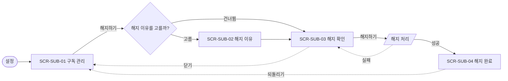

# 흐름도·화면 목록·상태 표 양식

출처: 국내 화면설계서 관례(이랜서 블로그「스토리보드/화면 설계서 작성법」2022, 요즘IT 정병준「IA, 메뉴구조도, 화면목록이 헷갈린다면?」2022, brunch @planbasic「IT 기획의 화면 정의서 폼 정의」2026), Google Material Design 3 Navigation bar 지침, Mermaid flowchart 문법. 양식은 이 저장소에서 정리했다.

## 1. 흐름도 범례 (Mermaid)

| 모양        | 뜻              | Mermaid                   |
| ----------- | --------------- | ------------------------- |
| 사각형      | 화면            | `A[SCR-SUB-01 구독 관리]` |
| 평행사변형  | 시스템 처리     | `B[/결제 취소 요청/]`     |
| 마름모      | 분기(예/아니요) | `C{해지 이유를 고를까?}`  |
| 둥근 사각형 | 시작·끝         | `S([시작])`               |
| 실선 화살표 | 사용자 행동     | `A -->                    | 해지하기 | B`  |
| 점선 화살표 | 예외·복구       | `B -.->                   | 실패     | E`  |

## 2. 화면 ID

- 형식 예: `SCR-<메뉴 코드>-<번호>` (`SCR-SUB-03`). 팀 규칙이 있으면 따른다.
- 고유하고, 지운 화면의 ID는 다시 쓰지 않는다.
- 문서 안에서 화면은 쪽수가 아니라 ID로 부른다.
- 화면의 추가·변경·삭제는 버전과 함께 개정 이력에 남긴다.

## 3. 화면 목록

| 화면 ID    | 화면명    | 유형     | 경로                 | 로그인 | 비고                     |
| ---------- | --------- | -------- | -------------------- | ------ | ------------------------ |
| SCR-SUB-01 | 구독 관리 | 페이지   | 설정 > 구독 관리     | 필요   |                          |
| SCR-SUB-03 | 해지 확인 | 대화상자 | 구독 관리 > 해지하기 | 필요   | 되돌릴 수 없는 결정 직전 |

유형: 페이지 · 대화상자 · 바텀시트 · 탭 · 외부 링크.

## 4. 화면×상태 표

| 화면 ID    | 기본           | 빈 상태             | 로딩     | 오류                    | 성공           | 권한 없음       | 끝             |
| ---------- | -------------- | ------------------- | -------- | ----------------------- | -------------- | --------------- | -------------- |
| SCR-SUB-01 | 구독 정보      | N/A — 구독자만 진입 | 스켈레톤 | 인라인 오류 + 다시 시도 | —              | 로그인 화면으로 | N/A            |
| SCR-SUB-04 | 해지 완료 안내 | N/A                 | N/A      | N/A                     | 남은 이용 기간 | N/A             | 다시 구독 경로 |

빈 칸을 두지 않는다. 해당 없으면 `N/A — 이유`, 확인하지 못했으면 `NOT_CHECKED`.

## 5. 정보구조

- 깊이는 0(홈)부터 3까지. 더 깊어지면 묶음을 다시 나눈다.
- 메뉴 이름은 사용자가 쓰는 말로, 내부 조직·시스템 이름을 쓰지 않는다.
- 한 항목이 두 묶음에 다 들어갈 것 같으면 이름이 모호하다는 신호다 — 트리 테스트로 확인한다.

## 6. 최상위 이동 패턴

| 상황                                          | 패턴                    |
| --------------------------------------------- | ----------------------- |
| 자주 오가는 최상위 목적지가 몇 개(보통 3~5개) | 하단 탭(내비게이션 바)  |
| 목적지가 많거나 자주 쓰지 않음                | 드로어·메뉴             |
| 같은 화면 안에서 보기 전환                    | 상단 탭·세그먼트 컨트롤 |
| 단계가 정해진 과제                            | 단계 표시 + 뒤로        |

## 7. 자주 빠지는 예외

- 중간에 앱을 나갔다 돌아옴, 세션 만료, 네트워크 끊김
- 같은 계정으로 두 기기에서 동시에 진행
- 권한 거부(알림·위치·카메라) 뒤의 경로
- 딥링크로 중간 화면에 바로 들어옴
- 결제·제출을 두 번 누름
